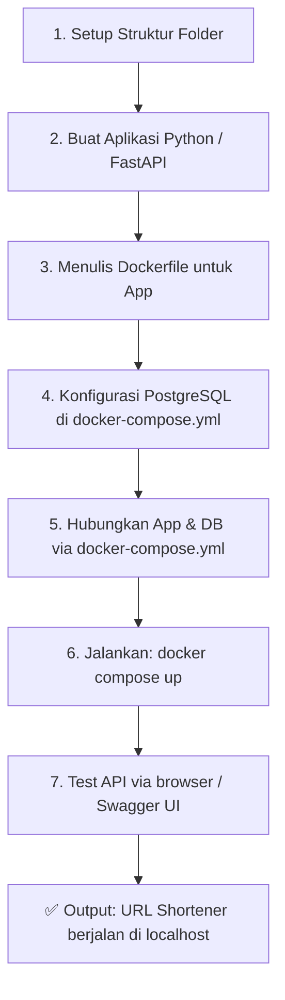
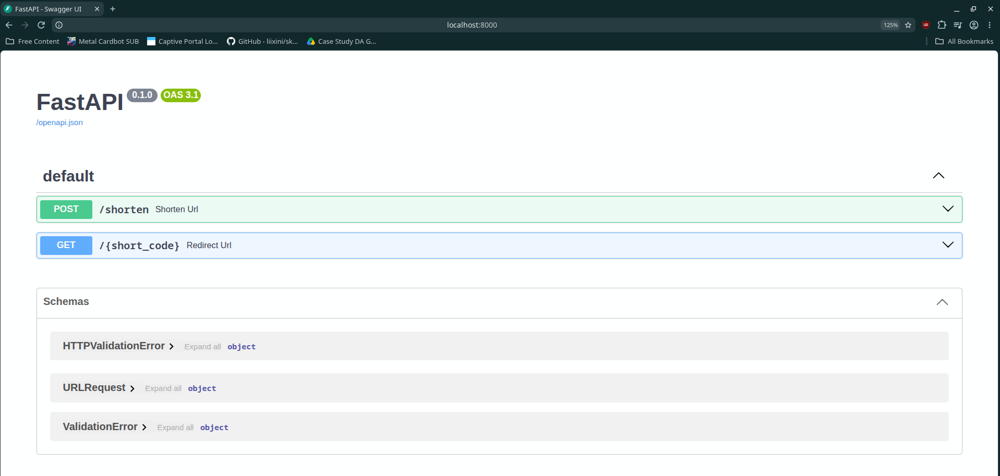
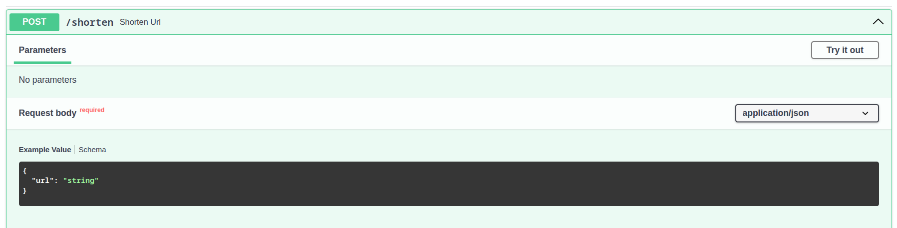
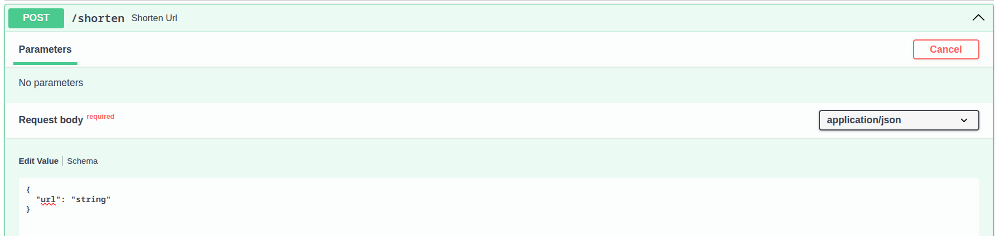
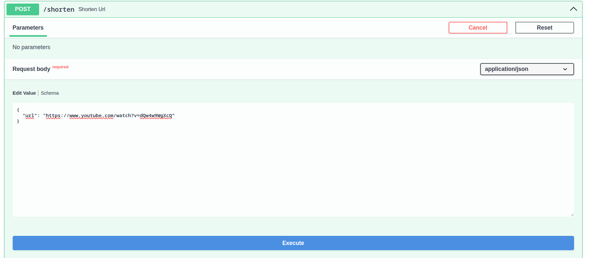
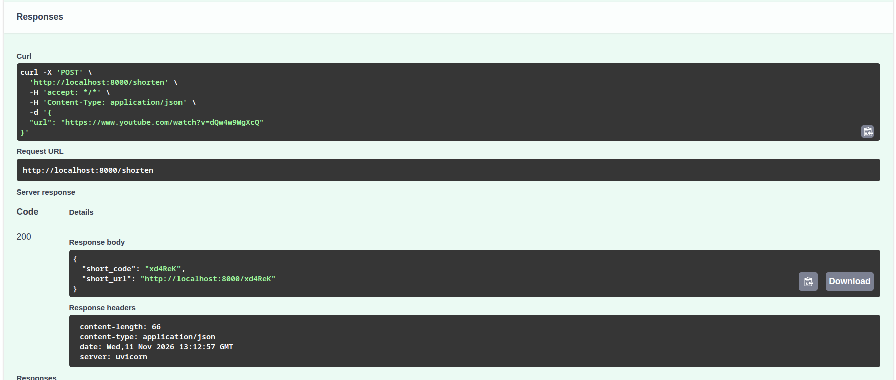
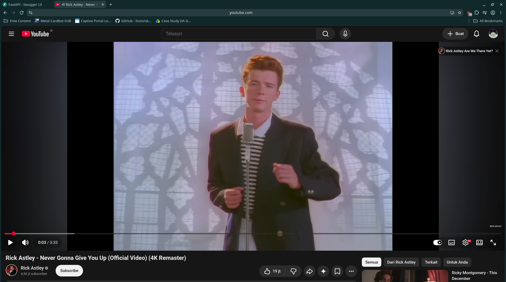

# 🔗 URL Shortener with Docker Compose

## Tujuan

Sebagai pembelajaran Docker Compose secara nyata, mulai dari Dockerfile, multi-container, volumes, sampai environment variables. Semua konsep dasar Docker dipraktikkan dalam satu project ini.

- Memahami cara kerja **Docker Compose**
- Belajar menghubungkan **multi-container** (Python app ↔ Database)
- Mempraktikkan konsep **Environment Variables**, **Volumes**, dan **Networks** di Docker

---

## Alur Project



---

## Struktur Folder

```
url-shortener/
├── app/
│   ├── main.py          ← kode FastAPI
│   └── requirements.txt ← daftar library Python
├── images/              ← screenshot dokumentasi
├── Dockerfile
└── docker-compose.yml
```

---

## Endpoints

| Endpoint | Fungsi |
|---|---|
| `POST /shorten` | Terima URL panjang → simpan ke DB → kembalikan short code |
| `GET /{short_code}` | Ambil short code → cari di DB → redirect ke URL asli |

---

## Cara Menjalankan

### Prasyarat
- Docker
- Docker Compose

### Jalankan

```bash
git clone https://github.com/username/url-shortener.git
cd url-shortener
docker compose up --build
```

Tunggu hingga muncul:
```
app-1  | INFO:     Application startup complete.
app-1  | INFO:     Uvicorn running on http://0.0.0.0:8000
```

Lalu buka browser ke: **http://localhost:8000/docs**

---

## Cara Penggunaan

### 1. Buka Swagger UI



### 2. Klik tombol POST `/shorten`



### 3. Klik **"Try it out"**



### 4. Isi URL lalu klik **Execute**



### 5. Lihat hasilnya — short code terbentuk!



### 6. Akses short URL di browser → redirect ke URL asli



---

## Teknologi yang Digunakan

| Teknologi | Fungsi |
|---|---|
| Python + FastAPI | Backend / API |
| PostgreSQL | Database |
| Docker Compose | Orkestrasi container |
| Uvicorn | ASGI server |

---

## Konsep Docker yang Dipelajari

- ✅ Menulis `Dockerfile` untuk aplikasi Python
- ✅ Menggunakan `docker-compose.yml` untuk multi-service
- ✅ Docker **Volumes** untuk persistent data
- ✅ **Environment Variables** untuk konfigurasi kredensial
- ✅ Docker **Networks** untuk komunikasi antar-container
- ✅ **Healthcheck** untuk memastikan DB siap sebelum app jalan
