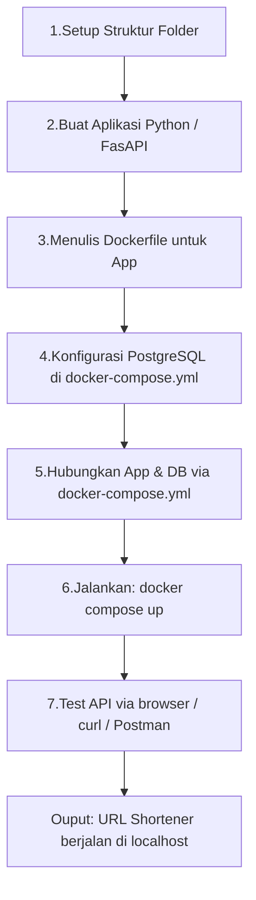

# Tujuan

Sebagai pembelajaran Docker Compose secara nyata, mulai dari Dockerfile, multi-container, volumes, sampai environment variables. Semua konsep dasar Docker dilakukan dalam satu project URL SHORTENER berikut ini.
********
- Memahami cara kerja Docker Compose
- Belajar menghubungkan multi-container
- Mempratikkan konsep Environment Variables, Volumes, dan Network di Docker

# Alur Project (Dari Awal Sampai Akhir)

# Struktur Folder

```
url-shortener/
├── app/
│   ├── main.py          ← kode FastAPI
│   └── requirements.txt ← daftar library Python
├── Dockerfile
└── docker-compose.yml
```

# Buat Aplikasi python (FastAPI)

Membuat 2 endpoint sederhana:

| Endpoint            | Fungsi                                                        |
| ------------------- | ------------------------------------------------------------- |
| `Post /shorten`     | Terima URL panjang --> simpan ke DB --> kembalikan short code |
| `GET /{short_code}` | Ambil short code --> cari di DB --> redirect ke URL asli      |
# Menyiapkan Folder
```
mkdir app
touch app/main.py app/requirements.txt Dockerfile docker-compose.yml
```
menyiapkan folder app, mengisinya dengan main.py dan requirements.txt. Sementara folder saat ini diberi Dockerfile dan docker-compose.yml

# Isi File main.py
```python
from fastapi import FastAPI, HTTPException
from fastapi.responses import RedirectResponse
from pydantic import BaseModel
import psycopg2
import os
import random
import string

app = FastAPI()

# Koneksi ke database
def get_db():
    conn = psycopg2.connect(
    host = os.getenv("DB-HOST", "db"),
    database = os.getenv("DB_NAME", "shortener"),
    user = os.getenv("DB_USER", "user"),
    password = os.getenv("DB_PASSWORD", "password")
    )
    return conn

# Buat tabel kalau belum ada
def init_db():
    conn = get_db()
    cur = conn.cursor()
    cur.execute("""
    CREATE TABLE IF NOT EXISTS urls (
    short_code VARCHAR(10) PRIMARY KEY,
    original_url TEXT NOT NULL
    )
    """)
    conn.commit()
    cur.close()
    conn.close()
    
# Jalanakan init saat app start
@app.on_event("startup")
def startup():
    init_db()

# Generate random short code
def generate_code(length=6):
    return ''.join(random.choices(string.ascii_letters + string.digits, k=length))

# Model request
class URLRequest(BaseModel):
    url:str
    
# Endpoint 1: Shorten URL
@app.post("/shorten")
def shorten_url(request: URLRequest):
    code = generate_code()
    conn = get_db()
    cur = conn.cursor()
    cur.execute("INSERT INTO urls (short_code, original_url) VALUES (%s, %s)", (code, request.url))
    conn.commit()
    cur.close()
    conn.close()
    return {"short_code": code, "short_url": f"http://localhost:8000/{code}"}

# Endpoint 2: redirect
@app.get("/{short_code}")
def redirect_url(short_code: str):
    conn = get_db()
    cur = conn.cursor()
    cur.execute("SELECT original_url FROM urls WHERE short_code = %s", (short_code,))
    result = cur.fetchone()
    cur.close()
    conn.close()
    if not result:
        raise HTTPException(status_code=404, detail="URL tidak ditemukan")
    return RedirectResponse(url=result[0])
```

# Isi File Dockerfile
```Dockerfile
FROM python:3.11-slim

WORKDIR /app

COPY app/requirements.txt
RUN pip install --no-cache-dir -r requirements.txt

COPY app/ .

EXPOSE 8000

CMD ["uvicorn", "main:app", "--host", "0.0.0.0", "--port", "8000"]
```

| Baris                    | Artinya                              |
| ------------------------ | ------------------------------------ |
| `FROM python:3,11-slim`  | Pakai base image Python versi ringan |
| `WORKDIR /app`           | set folder kerja di dalam container  |
| `COPY & RUN pip install` | Copy lalu install semua library      |
| `COPY app/ ,`            | Copy kode app ke dalam container     |
| `EXPOSE 8000`            | Buka port 8000                       |
| `CMD`                    | Perintah untuk jalankan app          |

# Isi File docker-compose.yml
```docker-compose.yml
services:
    app:
        build: .
        ports:
            - "8000:8000"
        environemnt:
            - DB_HOST=db
            - DB_NAME=shortener
            - DB_USER=user
            - DB_PASSWORD=password
        depends on:
            - db
            
    db:
        image: postgres:alpine
        environment:
            - POSTGRES_DB=shortener
            - POSTGRES_USER=user
            - POSTGRES_PASSWORD=password
        volumes:
            - db_data:/var/lib/postgresql/data

volumes:
    db_data:
```

| Bagian      | Fungsi                                |
| ----------- | ------------------------------------- |
| app         | Container untuk FastAPI               |
| db          | Container PostgreSQL resmi            |
| depends_on  | App nunggu DB siap dulu sebelum jalan |
| volumes     | Data DB tidak hilang saat restart     |
| environment | Kredensial yang sama antara app& DB   |

# Menjalankan Docker Compose
```
docker compose up --build
```

Output yang diinginkan adalah seperti berikut
```
app-1  | INFO:     Started server process [1]
app-1  | INFO:     Waiting for application startup.
app-1  | INFO:     Application startup complete.
app-1  | INFO:     Uvicorn running on http://0.0.0.0:8000 (Press CTRL+C to quit)
```

Buka localhost:8000 dan web akan muncul seperti ini![[Pasted image 20261111200913.png]]

# Penggunaan
- Tekan tombol POST![[Pasted image 20261111201008.png]]
- Kemudian klik tombol **"Try it out"** ![[Pasted image 20261111201143.png]]
- Ganti bagian **"string"** dengan url yang ingin dishorten lalu klik tombol execute.![[Pasted image 20261111201250.png]]
- Hasilnya akan terlihat pada bagian bawah.![[Pasted image 20261111201414.png]]
- Terlihat bahwa short_url terbentuk yakni **"http://localhost:8000/xd4Rek"**. Hasilnya dari url youtube menjadi url yang pendek tetap dapat mengarahkan pada video youtube yang sama.![[Pasted image 20261111201610.png]]